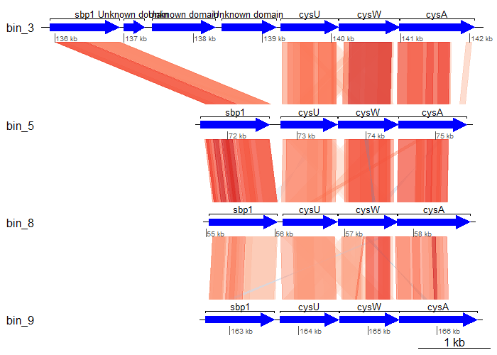
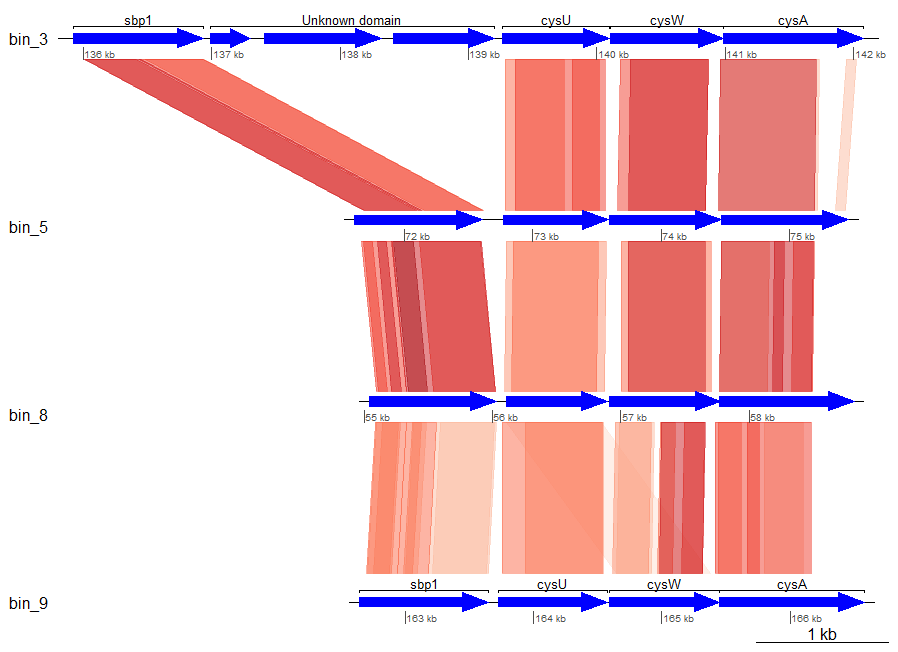

# Gene synteny

!!! info "Objectives"

    * [Build a sulfur assimilation gene alignment figure to investigate gene synteny using `R`](#build-a-sulfur-assimilation-gene-alignment-figure-to-investigate-gene-synteny-using-r)

---

## Build a sulfur assimilation gene alignment figure to investigate gene synteny using `R`

When investigating the evolution of genomes, we sometimes want to consider not only the presence/absence of genes in a genome, but also how they are arranged (e.g. in an operon). For this exercise, we are going to visualise several sulfur assimilation genes from our MAGs and compare their arrangements.

This exercise involves the use of commands in `bash` and `R`. Before starting, make sure you have an active terminal, then navigate to the directory `11.data_presentation/gene_synteny/`. Here, you'll find a copy of the annotations that came from DRAM (`dram_annotations.tsv`) and a directory of dereplicated bins in `dastool_bins/`. 


### 1. Obtain contigs containing genes of interest (R)

In an open RStudio session, set your working directory to `11.data_presentation/gene_synteny/` and then load the required libraries and annotation file.

!!! r-project "code"

    ```R linenums="1"
    # Working directory
    setwd("/nesi/nobackup/nesi02659/MGSS_U/<YOUR FOLDER>/11.data_presentation/gene_synteny/")

    # Tidyverse packages
    library(dplyr)
    library(readr)
    library(purrr)
    library(stringr)
    library(tidyr)

    # Gene synteny
    library(genoPlotR)

    # KEGG API
    library(KEGGREST)

    # Import annotations
    dram <- read_tsv("dram_annotations.tsv")
    ```

In order to be able to assimilate sulfate, prokaryotic genomes need to encode for the following KEGG orthologies which encode for an ATP-dependent thiosulfate/sulfate uptake system:

* K02045 (*cysA*)
* K02046 (*cysU*)
* K02047 (*cysW*)
* K02048 (*cysP*) or K23163 (*sbp*)

We'll subset the annotation file to obtain relevant rows and columns. In addtion to the bin and KO information, we require the gene position relative to the contig, strandedness, and the start and end position of the gene. 

!!! r-project "code"

    ```R linenums="1"
    genes_of_interest <- c("K02048", "K23163", "K02046", "K02047", "K02045")

    sulfate_assimilation <- dram %>%
      filter(ko_id %in% genes_of_interest) %>%
      select(fasta, scaffold, gene_position, ko_id, strandedness, start_position, end_position)
    ```

### 2. Check contiguity of genes

We need to check that the genes are contiguous (all on the same contig) and sequential. If there gaps between genes, we will need to fill them.

!!! r-project "code"

    ```R linenums="1"
    sulfate_assimilation %>%
      group_by(fasta) %>%
      distinct(scaffold) %>%
      tally(name = "n_contigs")
    ```

!!! circle-check "Console output"

    ```
    # A tibble: 4 × 2
      fasta n_contigs
      <chr>     <int>
    1 bin_5         1
    2 bin_7         2
    3 bin_8         1
    4 bin_9         1
    ```

We find that `bin_7` is discontiguous. We need to identify how the genes of interest are distributed across the 2 contigs.

!!! r-project "code"

    ```R linenums="1"
    sulfate_assimilation %>%
      group_by(fasta, scaffold) %>%
      tally(name = "n_genes")
    ```

!!! circle-check "Console output"

    ```
    # A tibble: 5 × 3
    # Groups:   fasta [4]
      fasta scaffold                                 n_genes
      <chr> <chr>                                      <int>
    1 bin_5 bin_5_NODE_55_length_158395_cov_1.135272       4
    2 bin_7 bin_7_NODE_54_length_158668_cov_0.373555       1
    3 bin_7 bin_7_NODE_96_length_91726_cov_0.379302        4
    4 bin_8 bin_8_NODE_12_length_355954_cov_0.516970       3
    5 bin_9 bin_9_NODE_62_length_149231_cov_0.651774       4
    ```

Let's also check which gene is not contiguous.

!!! r-project "code"

    ```R linenums="1"
    sulfate_assimilation %>%
      filter(fasta == "bin_7") %>%
      select(scaffold, gene_position, ko_id)
    ```

!!! circle-check "Console output"

    ```
    # A tibble: 5 × 3
      scaffold                                 gene_position ko_id 
      <chr>                                            <dbl> <chr> 
    1 bin_7_NODE_54_length_158668_cov_0.373555           136 K02048
    2 bin_7_NODE_96_length_91726_cov_0.379302             18 K02045
    3 bin_7_NODE_96_length_91726_cov_0.379302             19 K02047
    4 bin_7_NODE_96_length_91726_cov_0.379302             20 K02046
    5 bin_7_NODE_96_length_91726_cov_0.379302             21 K23163
    ```

Looks like there is a an operon that consists of *sbp* and *cysAUW*, then a discontiguous *cysP*. 

We also need to check for gaps between genes of interest.

!!! r-project "code"

    ```R
    select(sulfate_assimilation, scaffold, gene_position)
    ```

!!! circle-check "Console output"

    ```
    # A tibble: 16 × 2
       scaffold                                 gene_position
       <chr>                                            <dbl>
     1 bin_5_NODE_55_length_158395_cov_1.135272           128
     2 bin_5_NODE_55_length_158395_cov_1.135272           132
     3 bin_5_NODE_55_length_158395_cov_1.135272           133
     4 bin_5_NODE_55_length_158395_cov_1.135272           134
     5 bin_7_NODE_54_length_158668_cov_0.373555           136
     6 bin_7_NODE_96_length_91726_cov_0.379302             18
     7 bin_7_NODE_96_length_91726_cov_0.379302             19
     8 bin_7_NODE_96_length_91726_cov_0.379302             20
     9 bin_7_NODE_96_length_91726_cov_0.379302             21
    10 bin_8_NODE_12_length_355954_cov_0.516970           148
    11 bin_8_NODE_12_length_355954_cov_0.516970           149
    12 bin_8_NODE_12_length_355954_cov_0.516970           150
    13 bin_9_NODE_62_length_149231_cov_0.651774            55
    14 bin_9_NODE_62_length_149231_cov_0.651774            56
    15 bin_9_NODE_62_length_149231_cov_0.651774            57
    16 bin_9_NODE_62_length_149231_cov_0.651774            58
    ```

Here, we can see there is a gap in bin_5 where we need to fill 3 genes.

### 3. Subset relevant genes and positions

Based on the explorations above, we need to:

* Add genes 129-131 for scaffold `bin_5_NODE_55_length_158395_cov_1.135272`
* Remove `bin_7_NODE_54_length_158668_cov_0.373555`

!!! r-project "code"

    ```R linenums="1"
    # Add genes to bridge genes of interest for bin_5
    bin_5_additions <- dram %>%
      filter(scaffold == "bin_5_NODE_55_length_158395_cov_1.135272" & gene_position %in% 129:131) %>%
      select(fasta, scaffold, gene_position, ko_id, strandedness, start_position, end_position)

    # Remove extra scaffold from bin_7
    sulfate_assimilation <- sulfate_assimilation %>%
      group_by(scaffold) %>%
      # Our discontiguous scaffold only has one entry
      filter(n() > 1)

    # Combine both tables
    sulfate_assimilation_coords <- bind_rows(sulfate_assimilation, bin_5_additions) %>%
      arrange(scaffold, gene_position) %>%
      mutate(gene_id = paste0(scaffold, "_", gene_position))
    ```

We will write out the results for processing in `bash`.

!!! r-project "code"

    ```R linenums="1"
    walk(
      unique(sulfate_assimilation_coords$fasta),
      function(bin) {
        write_tsv(
          filter(sulfate_assimilation_coords, fasta == bin),
          paste0(bin, ".goi.tsv")
        )
      }
    )
    ```

### 4. Subset relevant scaffolds from bin sequences

Now, we need to return to the terminal. 

!!! warning "Check that you're in `11.data_presentation/gene_synteny/`"

We'll use the previously generated table information to extract the scaffolds (using `seqtk`) we need from bin files.

!!! terminal "code"

    ```bash linenums="1"
    module purge
    module load seqtk/1.4-GCC-11.3.0

    for i in *.goi.tsv; do
      bin=$(basename ${i} .goi.tsv)
      cut -f 2 ${i} | sed '1d' > tmp.scaffolds
      seqtk subseq dastool_bins/${bin}.fna tmp.scaffolds > ${bin}.goi.fna
    done
    ```

### 5. Compare scaffolds using tBLASTx

With our scaffolds ready, we can now perform pairwise comparisons between them. You can choose to generate complete combinations for comparisons. Here, we will only compare between bins sequentially. As we are using the `-subject` flag, the comparisons are single-threaded (we cannot change this).

!!! terminal "code"

    ```bash linenums="1"
    module purge
    module load BLAST/2.16.0-GCC-12.3.0

    bin_array=($(ls *.goi.fna | sed -e 's/.goi.fna//g'))

    i=0
    max_i=$(( ${#bin_array[@]}-1 ))

    while [ $i -lt $max_i ]; do
      qbin=${bin_array[$i]} # Current bin as query
      sbin=${bin_array[$(($i+1))]} # Next bin as subject 

      printf "Comparing %s against %s\n" ${qbin} ${sbin}

      tblastx -query ${qbin}.goi.fna \
              -subject ${sbin}.goi.fna \
              -out blast_${qbin}_${sbin}.txt \
              -outfmt "7 std ppos frames"
              
      ((i++)) # Increment i after each comparison
    done
    ```

??? hint "`-outfmt 7`"

    You may be familiar with BLAST output format 6 as the tabular output from BLAST. Here, format 7 is the one with a commented header lines. This allows `genoPlotR` downstream to parse the columns appropriately. The proceeding arguments specifies a standard output `std` with additional columns for percentage of positive matches `ppos` and the translated frames for query/subject `frames`.


Now we have all the necessary files. We will return to the RStudio session for plotting.

### 6. Plot gene synteny

We first need to import all the relevant per bin files.

!!! r-project "code"

    ```R linenums="1"
    # Gene coordinates
    goi_files <- list.files(pattern = ".*.goi.tsv")
    goi <- map(goi_files, function(x) read_tsv(x)) %>%
      setNames(nm = str_remove(goi_files, "\\..*"))

    # BLAST results
    blast_files <- list.files(pattern = "blast.*")
    blast <- map(blast_files, function(x) {
      read_comparison_from_blast(x)
    }) %>%
      setNames(nm = str_remove(blast_files, ".txt"))
    ```

We will also create a data frame that has relevant information about the gene. In this case, we are using the gene symbol.

!!! r-project "code"

    ```R linenums="1"
    ko <- unique(bind_rows(goi)$ko_id)
    kegg_records <- keggGet(ko[!is.na(ko)])
    ko_annot <- map(kegg_records, function(entry) {
        data.frame("ko_id" = entry[["ENTRY"]], 
                   "gene_symbol" = entry[["SYMBOL"]])
      }) %>%
      bind_rows()
    ```

We then create tracks of DNA segments and annotations that can be parsed by `genoPlotR`.

!!! r-project "code"

    ```R linenums="1"
    # DNA segments
    ds_list <- map(goi, function(x) {
      coords <- x %>%
        select(gene_id, start_position, end_position, strandedness)
      colnames(coords) <- c("name", "start", "end", "strand")
      dna_seg(coords)
    })

    # Annotations that include gene symbols
    annot_list <- map(goi, function(x) {
      data <- left_join(x, ko_annot, by = "ko_id") %>%
        select(gene_id, start_position, end_position, strandedness, ko_id, gene_symbol)
      annotation(
        x1 = data$start_position,
        x2 = data$end_position,
        text = ifelse(is.na(data$gene_symbol), "", data$gene_symbol)
      )
    })
    ```

Finally, we can plot!

!!! r-project "code"

    ```R linenums="1"
    plot_gene_map(
      dna_segs = ds_list,
      comparisons = blast,
      annotations = annot_list,
      dna_seg_labels = names(ds_list),
      dna_seg_scale = TRUE,
      gene_type = "arrows"
    )
    ```



Seems a little messy, let's clean it up a little by only keeping those with the best matches (i.e., minimum E-value).

!!! r-project "code"

    ```R linenums="1"
    filt_blast <- map(blast, function(x) {
      group_by(x, name1, name2) %>%
        filter(e_value == min(e_value)) %>%
        ungroup() %>%
        as.comparison()
    })

    # Re-plot
    plot_gene_map(
      dna_segs = ds_list,
      comparisons = filt_blast,
      annotations = annot_list,
      dna_seg_labels = names(ds_list),
      dna_seg_scale = TRUE,
      gene_type = "arrows"
    )
    ```



Much better! To further improve the plot, you might want to rearrange the tBLASTx comparisons and perhaps add additional information to the un-annotated genes based on hits to other databases (e.g., Pfam, TIGRFam, UniProt, etc.).
