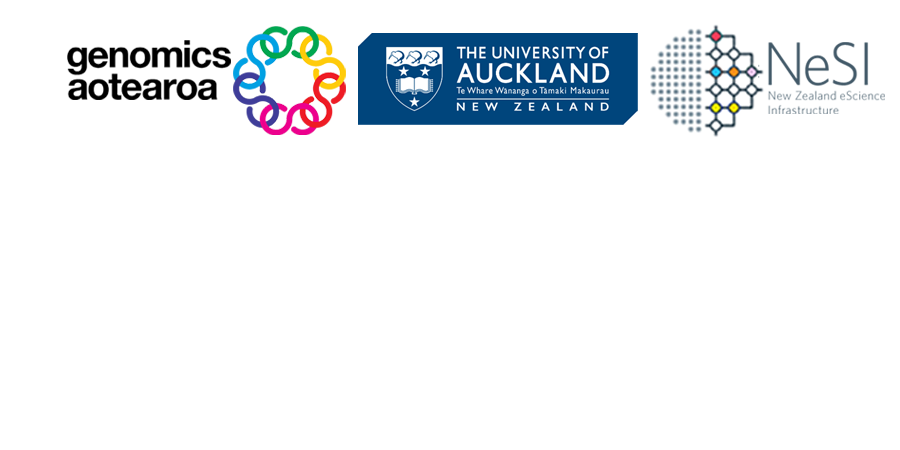

{.center width="350"}

# **Metagenomics Summer School**

- - - 

| 
Day
 | 
Lesson topic
 |
| --- | --- |
| [Day 1: Assembly](#){ .md-button .md-button--primary } | [1. Filter raw reads by quality](./day1/ex_01_quality_filtering.md) [2. Assembly I: Assembling contigs](./day1/ex_02_assembling_contigs.md) [3. Assembly II: Variable parameters](./day1/ex_03_assembly_parameters.md) [4. Assembly evaluation](./day1/ex_04_assembly_evaluation.md) [BONUS: Assembling contigs: IDBA-UD](./day1/ex_05_assembly_idba-ud.md) |
| [Day 2: Binning and annotation](#){ .md-button .md-button--primary } | [1. Introduction to binning](./day2/ex_06_binning_intro.md) [2. Binning I: Bin with multiple tools](./day2/ex_07_binning_tools.md) [3. Binning II: Bin dereplication](./day2/ex_08_bin_dereplication.md) [4. Assigning taxonomy to refined prokaryotic bins](./day2/ex_09_taxonomy.md) [5. Phylogenomics](./day2/ex_10_phylogenomics.md) [6. Gene prediction](./day2/ex_11_gene_prediction.md) [7. Gene annotation I: DRAM](./day2/ex_12_gene_annotation_DRAM.md) [BONUS: Gene annotation I: BLAST + HMM](./day2/ex_13_gene_annotation_various.md) |
| [Day 3: Visualisation](#){ .md-button .md-button--primary } | [1. Gene annotation II: DRAM distillation](./day3/ex_14_gene_annotation_DRAM_distillation.md) [2. Bin coverage 1: Dereplication](./day3/ex_15_bin_coverage_dereplication.md) [3. Bin coverage 2: Coverage calculation](./day3/ex_16_bin_coverage_mapping.md) [4. Introduction to data presentation](./day3/ex_17_data_presentation_intro.md) [5. Coverage heatmaps](./day3/ex_18_data_presentation_coverage.md) [6. KEGG pathway maps](./day3/ex_19_data_presentation_KEGG_pathways.md) [7. Gene synteny](./day3/ex_20_data_presentation_gene_synteny.md) |

 

## :material-calendar: Timetable 2026

=== "Day 1: Wednesday, 2nd Dec"

    | 
Time
 | 
Event
 | 
Session leader
 |
    | --- | --- | --- |
    | 12:00 &ndash; 12:30 | **Introductions** Welcome Overview Login to HPC via [OnDemand](https://ondemand.nesi.org.nz/public/)  | NAME |
    | 12:30 &ndash; 13:00 | :fontawesome-solid-microphone-lines: **TALK** Metagenomics decision tree :octicons-comment-discussion-16: **DISCUSSION** What are your research questions? | NAME |
    | 13:00 &ndash; 14:00 | **Filter raw reads by quality** :fontawesome-solid-microphone-lines: **TALK** Quality filtering raw reads :fontawesome-solid-laptop-code: **TASK** Filter raw reads by quality | NAME |
    | 14:00 &ndash; 14:20 | :material-tea: *Afternoon tea* | |
    | 14:20 &ndash; 15:30 | **Assembly I: Assembling contigs** :fontawesome-solid-microphone-lines: **TALK** Choice of assemblers, parameter considerations, and when to stop! :fontawesome-solid-laptop-code: **TASK** Assemble contigs and submit jobs to NeSI via Slurm | NAME |
    | 15:30 &ndash; 16:15 | **Assembly II: Variable parameters** :fontawesome-solid-laptop-code: **TASK** Explore assembler options and submit variant assembly jobs | NAME |
    | 16:15 &ndash; 17:00 | **Assembly evaluation** :fontawesome-solid-microphone-lines: **TALK** Assembly evaluation :fontawesome-solid-laptop-code: **TASK** Evaluate your assemblies | NAME |

=== "Day 2: Thursday, 3rd Dec"

    | 
Time
 | 
Event
 | 
Session leader
 |
    | --- | --- | --- |
    | 09:00 &ndash; 09:10 | **Introductions** Recap of day 1 Overview of the day | NAME |
    | 09:10 &ndash; 10:30 | **Binning** :fontawesome-solid-microphone-lines: **TALK** Introduction to binning: history and key parameters :fontawesome-solid-laptop-code: **TASK** Binning I: Bin with multiple tools | NAME |
    | 10:30 &ndash; 10:50 | :material-tea: *Morning tea* | |
    | 10:50 &ndash; 12:00 | **Binning II: Bin dereplication** :fontawesome-solid-microphone-lines: **TALK** Binning strategies :fontawesome-solid-laptop-code: **TASK** Bin dereplication | NAME |
    | 12:00 &ndash; 13:00 | :material-silverware-fork-knife: *Lunch* | |
    | 13:00 &ndash; 13:45 | **Assigning taxonomy to refined prokaryotic bins** :fontawesome-solid-microphone-lines: **TALK** Taxonomic classification: bin and species determination :fontawesome-solid-laptop-code: **TASK** Assign taxonomy to refined bins | NAME |
    | 13:45 &ndash; 14:30 | **Phylogenomics** :fontawesome-solid-microphone-lines: **TALK** Primer to phylogenetic analyses :fontawesome-solid-laptop-code: **TASK** Build and visualise a phylogenetic tree | NAME |
    | 14:30 &ndash; 14:50 | :material-tea: *Afternoon tea* | |
    | 14:50 &ndash; 15:30 | **Gene prediction** :fontawesome-solid-microphone-lines: **TALK** Tools for predicting genes :fontawesome-solid-laptop-code: **TASK** Predict genes | NAME |
    | 15:30 &ndash; 16:30 | **Gene annotation I: DRAM** :fontawesome-solid-microphone-lines: **TALK** Methods for gene annotation :fontawesome-solid-laptop-code: **TASK** Annotate genes with DRAM | NAME |
    | 16:30 &ndash; 17:00 | :octicons-comment-discussion-16: **DISCUSSION** How will you approach your research question? | NAME |

=== "Day 3: Friday, 4th Dec"

    | 
Time
 | 
Event
 | 
Session leader
 |
    | --- | --- | --- |
    | 09:00 &ndash; 09:10 | **Introductions** Recap of day 2 Overview of the day | NAME |
    | 09:10 &ndash; 10:10 | **Gene annotation II: DRAM distillation** :fontawesome-solid-microphone-lines: **TALK** Overview of DRAM results :fontawesome-solid-laptop-code: **TASK** DRAM distillation | NAME |
    | 10:10 &ndash; 10:30 | :material-tea: *Morning tea* | |
    | 10:30 &ndash; 11:15 | **Bin coverage 1: Dereplication** :fontawesome-solid-laptop-code: **TASK** Dereplicate bins for coverage calculation | NAME |
    | 11:15 &ndash; 12:00 | **Bin coverage 2: Coverage calculation** :fontawesome-solid-laptop-code: **TASK** Map reads and calculate bin coverage | NAME |
    | 12:00 &ndash; 13:00 | :material-silverware-fork-knife: *Lunch* | |
    | 13:00 &ndash; 13:40 | **Introduction to data presentation** :fontawesome-solid-microphone-lines: **TALK** Visualising genomic, metabolic and environmental features | NAME |
    | 13:40 &ndash; 14:30 | **Coverage heatmaps** :fontawesome-solid-laptop-code: **TASK** Coverage heatmaps | NAME |
    | 14:30 &ndash; 14:50 | :material-tea: *Afternoon tea* | |
    | 14:50 &ndash; 15:50 | **KEGG pathway maps** :fontawesome-solid-laptop-code: **TASK** KEGG pathway maps | NAME |
    | 15:50 &ndash; 16:40 | **Gene synteny** :fontawesome-solid-laptop-code: **TASK** Gene synteny | NAME |
    | 16:40 &ndash; 16:50 | :fontawesome-solid-laptop-code: **TASK** Workshop survey | |
    | 16:50 &ndash; 17:00 | :material-hand-wave: **Wrap up and final discussions** | NAME |

 

!!! example "Appendices"

    |Appendix ID                                         |                        | 
    |:---------------------------------------------------|:---------------------------------------|
    |[Appendix 1](#){ .md-button    } | [Text](./resources/file.md) |

 

!!! comment-dots "Post-workshop survey"
    
    Thank you for attending Metagenomics Summer School 2026! We would like your feedback on how we have done and what we can improve on. You can provide feedback [here ADD LINK]().

 

!!! copyright "License"

    Genomics Aotearoa / New Zealand eScience Infrastructure / University of Auckland **Metagenomics Summer School** material is licensed under the **GNU General Public License v3.0, 29 June 2007**. ([Follow this link for more information](https://github.com/GenomicsAotearoa/shell-for-bioinformatics/blob/main/LICENSE))

 

!!! note "Slides for workshop"

    You can find a copy of the slides presented during the workshop, with published figures removed, in the [slides/](https://github.com/GenomicsAotearoa/metagenomics_summer_school/tree/master/slides) folder.

 

!!! desktop-download-24 "Snapshots of results to download"

    If you are having trouble downloading files using `scp`, we are providing exemplar output files, which you can download through your browser, [here](https://github.com/GenomicsAotearoa/metagenomics_summer_school/tree/master/docs/resources), or via the following links: 
    
    * [FastQC results](./resources/fastqc_results.zip)
    * [Quast results](./resources/quast_results_sans_reference.zip) and [required references](./resources/quast_references.zip)
    * [Input files for VizBin](./resources/vizbin_files.zip)
    * [Gene annotation tables](./resources/example_annotation_tables.zip)
    * [DRAM output files](./resources/dram_distillation.zip)
